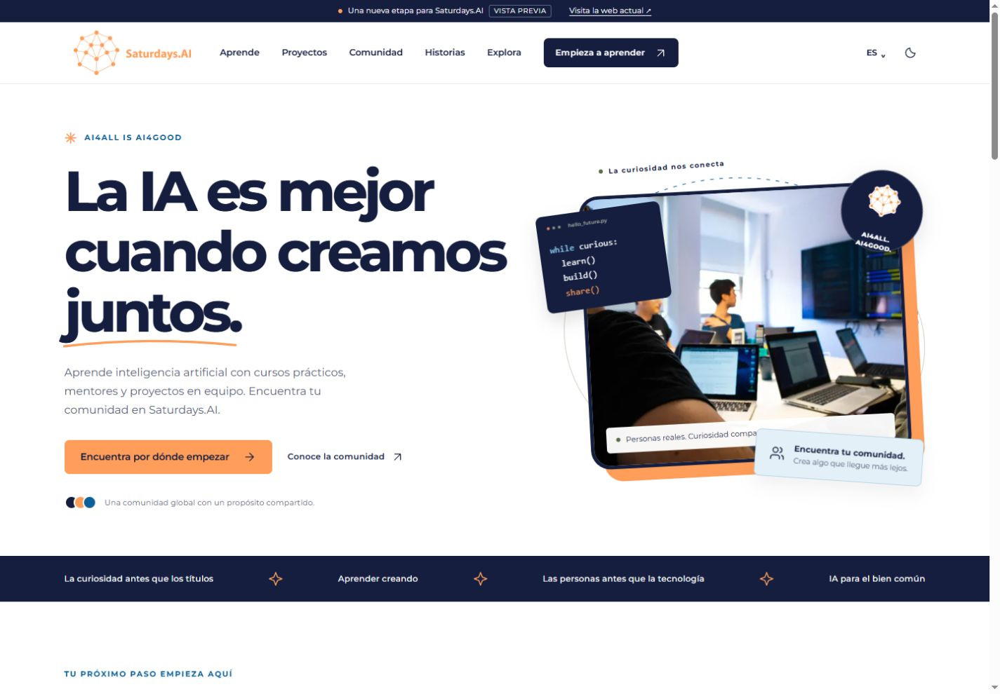
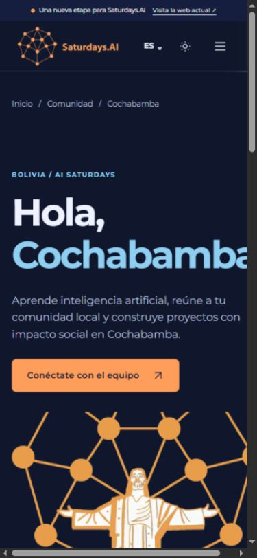
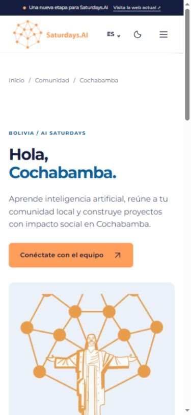
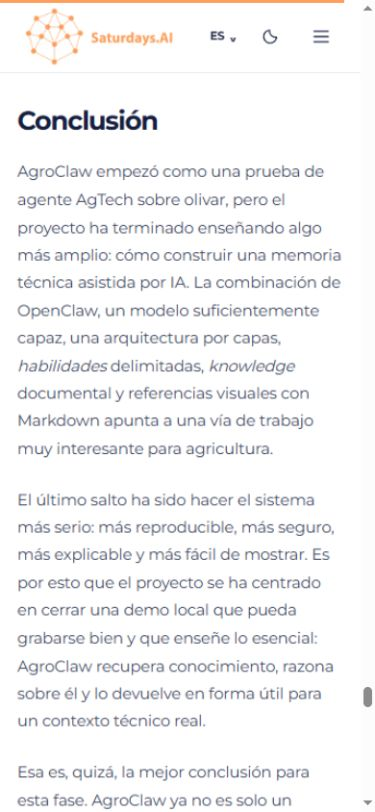
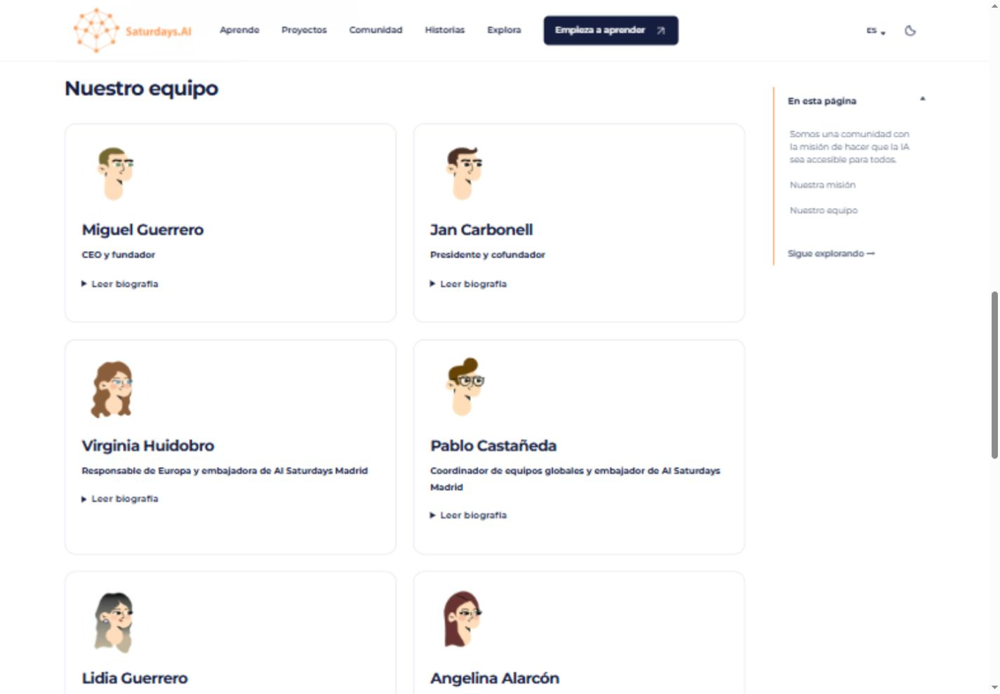

# Auditoría y mejora de la versión española

Fecha: 25 de octubre de 2026. Destino: [piloto en GitHub Pages](https://saturdaysai.github.io/saturdaysai-web/?lang=es).

La revisión combina el informe y las capturas del ZIP aportado, inspección del código, análisis de todas las páginas españolas generadas y pruebas nuevas en navegador. El ZIP se ha tratado como evidencia previa: sus observaciones no se dan por vigentes sin contrastarlas. Las mejoras se aplican al piloto; el dominio `saturdays.ai`, WordPress, DNS y correo no forman parte del despliegue.

## Resultado y alcance

La navegación principal, las ciudades y la lectura de artículos tienen una base más sólida: ya no se reproduce el desbordamiento de Cochabamba, las imágenes reservan espacio antes de cargar, el índice salta al encabezado y el menú móvil permite recorrerlo y cerrarlo con teclado. Se han corregido traducciones visibles, restos de Markdown y páginas de contacto poco útiles. Las biografías están organizadas en fichas y los archivos anuales cargan visualmente por tandas.

Esto no equivale a una revisión editorial humana de cada frase del archivo ni a una certificación de accesibilidad. La versión inglesa se conserva; esta auditoría editorial y de experiencia se centra en español.

| Cobertura | Evidencia |
| --- | --- |
| 458 documentos españoles generados | Análisis de idioma, encabezados, residuos de importación y textos alternativos |
| 916 documentos entre los dos idiomas | Verificación de enlaces internos, metadatos, imágenes y alternancias de idioma |
| 162 artículos originales | Se conservan las rutas de migración y el contenido editorial |
| 23 ciudades | Recorrido en navegador con viewport de 320 px; sin desbordamiento horizontal |
| Navegación y plantillas principales | Muestras en 320, 390, 1280 y 1440 px; temas claro y oscuro |
| Interacciones | Menú, teclado, índice, búsqueda, estado vacío, paginación, biografías, preferencias y carga del reproductor |

## Recorridos y correcciones

### 1. Llegar a la portada y entender qué ofrece Saturdays.AI

**Estado: mejorado.** La portada explica cursos prácticos, mentores y proyectos en equipo. Un bloque resume AI Saturdays, las sesiones, el proyecto y el Demo Day, y enlaza al programa. Se mantiene el lema de marca. Se sustituyó la segunda fotografía repetida por otra imagen real de la comunidad. Se corrigió una frase truncada del archivo de portada y un enlace antiguo a Eduflow.

### 2. Elegir un curso o una comunidad

**Estado: funcional en las pruebas realizadas.** Se corrigieron términos como «ingeniería rápida» y «cara de abrazo» por «Ingeniería de prompts» y «Hugging Face». Los mensajes y llamadas a la acción de ciudades son más naturales. Las fechas de próximas ediciones se consultan con cada equipo; no se han inventado convocatorias ni disponibilidad.

El nombre de Cochabamba excedía la anchura disponible. Ahora los títulos se adaptan, los elementos de la cuadrícula pueden encogerse y los logotipos de ciudad se muestran completos. Se revisaron también Copenhague, Guadalajara, Santiago de Compostela y el resto del catálogo de ciudades a 320 px.

| Antes, 390 px | Después, 390 px |
| --- | --- |
|  |  |

La ficha externa de «Prompt Engineering + Context + Agents» abre correctamente en el navegador. Esa plataforma conserva contenido propio en inglés. Las dos invitaciones de Discord enlazadas devolvieron 404 en su API pública; se sustituyeron por contacto con la comunidad para solicitar los canales vigentes. No se ha probado la compra, inscripción, emisión de certificados ni la entrega de formularios externos.

### 3. Encontrar proyectos, historias y episodios

**Estado: mejorado.** Tres artículos de opinión dejaron de aparecer como proyectos. Se muestra una sola versión del proyecto duplicado de turbofán en el listado, conservando ambas URLs y artículos. Los proyectos incluyen contexto de aprendizaje, sin presentarlos como productos validados para su despliegue.

Los archivos anuales muestran inicialmente 12 artículos, con un botón para ver más y foco de teclado en el primer resultado nuevo. La prueba del archivo de 2022 pasó de 12 a 24 resultados visibles sobre 66. La búsqueda de «AgroClaw» devuelve una historia; una búsqueda sin coincidencias muestra un estado vacío y una acción de recuperación. El índice de recursos evita varias rutas duplicadas o de utilidad interna, que siguen existiendo para mantener compatibilidad.

### 4. Leer un artículo largo desde el móvil

**Estado: corregido en las pruebas realizadas.** Las imágenes pendientes de carga tenían tamaño calculado cero, a pesar de disponer de dimensiones HTML. Al eliminar la regla que anulaba su anchura, reservan su espacio. En la prueba móvil, las primeras imágenes pendientes ya ocupaban 339 px de ancho y alturas correspondientes a su proporción.

El índice cierra su desplegable móvil antes de saltar, mueve el foco al encabezado y realiza un salto inmediato. En AgroClaw, «Conclusión» quedó visible bajo la cabecera, aproximadamente a 110 px del borde superior. Las primeras capturas durante una animación de desplazamiento no se usan como medida de error: eran estados intermedios.

Se repararon enlaces partidos, encabezados con asteriscos, timestamps dañados y restos de widgets de artículos relacionados importados. El árbol de archivos de AgroClaw vuelve a ser un bloque de código. Se mantienen los ejemplos y prompts que contienen Markdown de forma intencionada.

### 5. Conocer al equipo y contactar

**Estado: mejorado.** Las nueve biografías se presentan como fichas, con lectura desplegable y una cuadrícula adaptable. Se conservan los textos, perfiles y anclas. Se corrigió el enlace de Beñat, el avatar repetido de Christian y la traducción del nombre de Jan. Las funciones y cifras procedentes del sitio anterior llevan una nota de contexto histórico pendiente de confirmación.

La página de contacto distingue consultas generales, comunidades locales y organización de nuevas iniciativas. La página de participación elimina frases comerciales incompletas y explica cómo aprender, compartir, mentorizar u organizar. Se conserva la exclusión de información económica en las páginas generales y de ciudades; no se aplica esa exclusión a los artículos del blog.

### 6. Navegar con teclado y preferencias

**Estado: funcional en las pruebas realizadas.** El menú móvil muestra un icono de cierre, bloquea el desplazamiento del fondo y marca el contenido de fondo como `inert`. Se verificaron Tab, Shift+Tab y Escape, incluyendo la devolución del foco al botón. Los encabezados importados ya no saltan niveles por usar h5 o h6. Se corrigieron textos alternativos que eran nombres de archivo y se identificaron logotipos mediante inspección visual.

El tema oscuro se conserva al navegar. La preferencia de idioma continúa disponible de forma discreta. La selección automática utiliza el idioma del navegador, no una localización por IP. Las imágenes decorativas no reciben descripciones inventadas.

## Rendimiento y SEO

Las peticiones HTTP al piloto publicado se midieron en esta conexión de escritorio, en siete rutas y tres repeticiones por ruta. Todas respondieron con 200. La primera petición de cada ruta recibió cabeceras en aproximadamente 149–264 ms y terminó de descargar el documento en 154–277 ms; las repeticiones terminaron en 21–46 ms. Estas cifras **no son LCP, INP o CLS**, ni representan una red móvil real. Tampoco prueban por sí solas la experiencia de carga de todas las imágenes.

Los controles de tamaño verifican HTML representativo por debajo de 60 KB comprimidos y CSS por debajo de 25 KB. En la construcción revisada, el CSS comprimido ocupa aproximadamente 12 KB; la portada 13.4 KB; el archivo de historias 46.7 KB. Hay 1.761 imágenes originales indexadas y 1.300 variantes de 480 px, con un ahorro agregado del 74,1 % frente a sus originales. Los reproductores de terceros se cargan tras una acción del visitante: el episodio probado tenía cero iframes antes de pulsar y el iframe de Acast después.

Se mantienen títulos, descripciones, canonicals, datos estructurados, alternancias de idioma y tarjetas sociales con identidad de Saturdays.AI. Se verifican 445 tarjetas de 1200 × 630. Para el futuro sitio de producción se excluyen de indexación los archivos duplicados por año, «sin categoría» y las etiquetas con un único artículo; las categorías y etiquetas útiles siguen siendo indexables. Las URLs continúan disponibles. **Todo el piloto conserva `noindex`** hasta la decisión de cambiar el dominio.

## Verificación y mantenimiento

- `npm run verify`: comprobación de Astro, 33 pruebas automatizadas, compilación estática, enlaces y fragmentos internos, imágenes, rendimiento, tarjetas sociales y localización.
- Pruebas de regresión nuevas para niveles de encabezados, conservación de biografías/enlaces/anclas y exclusión selectiva de archivos del índice de búsqueda.
- Textos editables en Markdown y catálogos de traducción. Las mejoras del equipo se aplican al HTML generado sin crear un segundo modelo de contenido.
- Evidencia local adicional en `artifacts/spanish-audit-2026-10-25/`: informe recibido, capturas originales, escaneo por ruta, medidas HTTP y resultados de compilación. Ese material auxiliar no se publica como parte de la web.

## Pendientes antes de cambiar el dominio

1. **Validación legal:** confirmar identidad y datos del responsable, política vigente de privacidad y términos aplicables. La página de términos señala honestamente que la validación está pendiente; no se presenta como documento jurídico definitivo.
2. **Vigencia organizativa:** confirmar cargos del equipo, cifras de impacto y próximas convocatorias. El archivo histórico se conserva con contexto; no demuestra actividad actual.
3. **Prueba en dispositivos reales:** iPhone/Safari, Android, lector de pantalla y redes móviles. La emulación de anchura en el navegador de escritorio no sustituye estas pruebas ni permite declarar cumplimiento integral de WCAG.
4. **Datos de experiencia real:** obtener LCP, INP y CLS con medición de laboratorio o datos de campo adecuados. No se atribuye una puntuación Lighthouse que no se haya obtenido.
5. **Revisión editorial continua:** las traducciones automáticas siguen siendo editables y requieren revisión humana para matices de todo el archivo. Los enlaces históricos y plataformas externas pueden cambiar independientemente del repositorio.

No se ha cambiado el dominio de producción.
